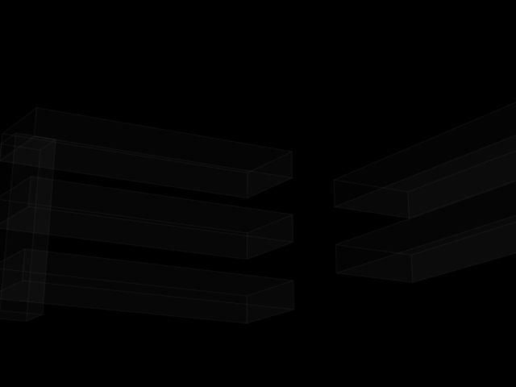

# Rhythmer OS

Developed by **jazzy rhythmer**. [Instagram](https://www.instagram.com/jazzyrhythmer/) · [YouTube](https://www.youtube.com/@jazzyrhythmer)

**0.4.0-beta.1**, an MPC Sample beta for owner device testing, based on **Melodee 0.2.0 by Kerem Kiliç (Ellic Studio)**. Existing sampler, sequencer, mixer, effects, driver and recovery foundations are retained.

The plugin picker contains 20 entries: Rhythmer Kit, Acid Engine, Break Engine, Sophie, Elixir, Aphex, FM-106, FMini-1, CS-1, OberVave, K-WASUB, Hera, Braids, Plaits, Hortator, MONO2K, Prophet, S1Vave, Dexed, Guru-600. The original Sample Kit remains available through the native sampler. See [engine inventory](docs/ENGINE_REGISTRY.md).

Rhythmer Kit has 36 named kit presets with pads 1–16 filled. Kit-wide switching, pad-specific engine/sound editing, user presets and project saving are supported. Individual instruments play one selected sound through chromatic/scale pads, with named presets and functional control pages, current/total position and direct PAGES navigation. Their common home shows original engine name, preset, selected pad, common track controls and input-reactive monochrome animation.

GEN uses the original FM-1 Rhythmer generator: choose tracks 1–4, 5–8, 9–12 or 13–16. The first track receives a kit, the remaining three instruments and MIDI. MIDI ONLY supports a range or one track. Acid/Break actions follow the selected engine. Break audio is browsed from user storage; 1–4 declared source bars are synchronized and sliced. No break recordings are bundled.

[Build](docs/BUILD.md) · [Sound and kits](docs/SOUND_KIT_GUIDE.md) · [GEN](docs/GEN_WORKFLOW.md) · [Installation and recovery](docs/SD_CARD_GUIDE.md) · [Validation](docs/VERIFICATION.md) · [Credits](THIRD_PARTY_NOTICES.md).

Excluded engine source folders and package resources are removed from this release. Shared dependencies, upstream authorship and license notices are preserved. Public source exports omit private history and conversations. Offline builds and host tests do not establish physical-device behavior; physical-device validation remains pending.

Current beta UI/preset audit: [FINAL_UI_AUDIT.md](docs/FINAL_UI_AUDIT.md), observed checks: [VERIFICATION.md](docs/VERIFICATION.md).

Break Engine includes the pinned FM-1 Rhythmer Amenity/Jungle performance DSP, BRK PERF controls and recorded performance commands. Acid GEN uses the original TB-3PO laws with per-track settings, 32-bit seeds and sustained ties. See [Break and Acid guide](docs/BREAK_ACID_GUIDE_KO.md).

The 0.4 integration adds the new upstream 128-pattern Patterns home, Freeze/Deep Freeze, LV2/CLAP hosting, native pad sends, USB web/files and screen mirroring. GEN moves to Shift+B3 on PATTERNS. The integration and limitations are in [UPSTREAM_020.md](docs/UPSTREAM_020.md). Updates use a separate Rhythmer signature; an upstream Melodee ZIP is not a Rhythmer update.

The curated sound catalogue contains 2,520 retained original selections plus 43 explicitly authored Rhythmer selections: 15 Prophet sounds and four seven-voice Elixir kits. External Sequential/Erica/Hrtl banks are excluded. See [Rhythmer presets](docs/RHYTHMER_PRESETS.md) and [bank provenance](docs/ORIGINAL_PRESET_AUDIT_KO.md).

## Install the beta

[Download the latest beta](https://github.com/JazzyRhythmer/mpc-sample-rhythmer-os/releases) · [Installation and recovery guide](docs/SD_CARD_GUIDE.md) · [Website and web manual](https://jazzyrhythmer.github.io/mpc-sample/) · [Engine port sources](https://github.com/JazzyRhythmer/mpc-sample-engine-ports)

Use the complete **SD.zip** for first installation and the 0.4 transition. **UPDATE.zip** updates only a compatible Rhythmer application; it does not replace plugin/kit data. Back up projects, samples and the card first. Verify the release checksums and the AC50 / stock firmware 1.3.0.12 requirement in the installation guide. SOURCE, MOVE-SOURCE and SUPPORT-SOURCE archives contain corresponding source, not installers.

This is an unofficial project, not affiliated with or endorsed by AKAI Professional or inMusic. Product names and logos belong to their respective owners. Provided without warranty under the applicable licenses. This beta has offline build, audio-host and UI checks; physical-device behavior, latency and recovery still require owner testing.
