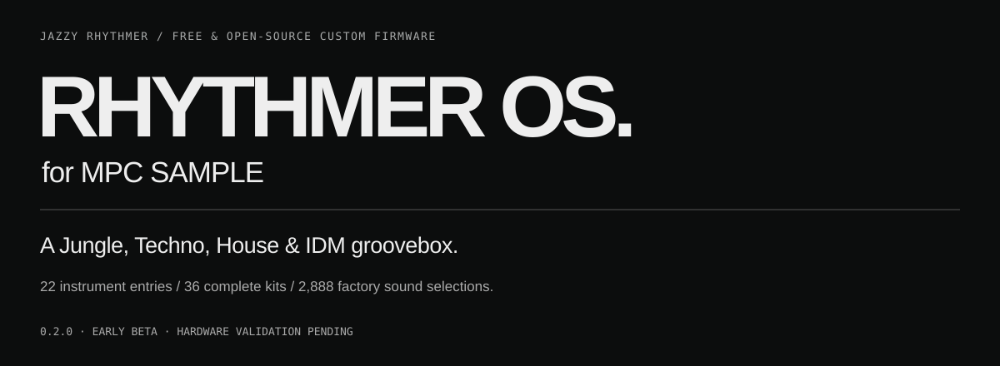
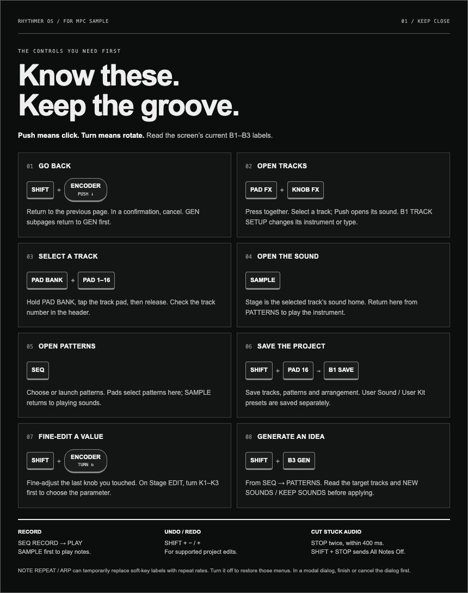
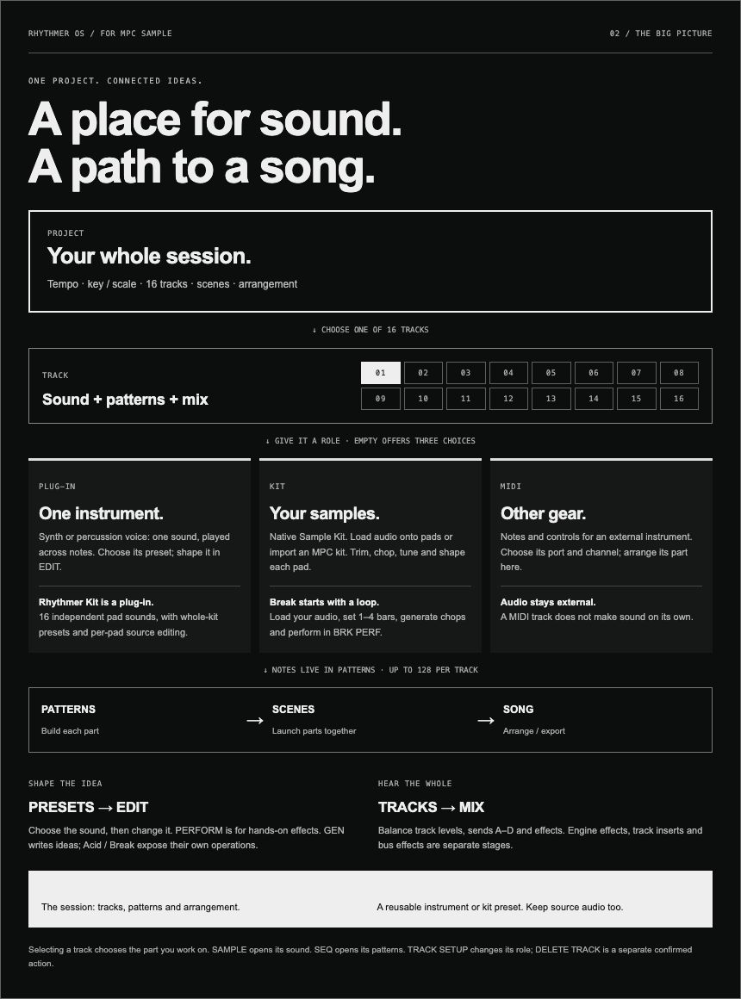

Turn your MPC Sample into an exploratory groovebox: diverse synth engines, hands-on drums, chopped breaks and new ways to find a pattern.

**[DOWNLOAD & INSTALL](https://jazzyrhythmer.github.io/mpc-sample/installer/)** · **[MAKE YOUR FIRST PATTERN](https://jazzyrhythmer.github.io/mpc-sample/manual/quickstart.html)** · **[READ THE MANUAL](https://jazzyrhythmer.github.io/mpc-sample/manual/)** · **[WEBSITE](https://jazzyrhythmer.github.io/mpc-sample/)**

Free and open-source custom firmware by **jazzy rhythmer**, built on **Melodee 0.2.0 by Kerem Kiliç (Ellic Studio)** and the work of the original engine authors.

*UI images are development renders, not photographs or proof of hardware validation.*

## Start with a track

Select a track with **PAD BANK + Pad 1–16**. Tap **SAMPLE** to open its sound, **SEQ** for its patterns, or **PAD FX + KNOB FX together** for TRACKS. An EMPTY track offers **PLUG-IN / KIT / MIDI**. For an assigned track, **TRACKS → B1 TRACK SETUP** changes its instrument or type; deleting the entire track is a separate confirmed action.

**Back is SHIFT + encoder Push.** SHIFT + encoder **turn** fine-adjusts the last-touched knob instead. In PATTERNS the pads choose patterns; return with SAMPLE before playing instrument notes.

[Full first-session guide](docs/GETTING_STARTED_KO.md) · [Instrument/type changes](docs/TRACK_WORKFLOW.md)

## The essential controls — one page

[Open or print the control reference](https://jazzyrhythmer.github.io/mpc-sample/manual/essentials.html).

## The OS, at a glance

[Open or print the OS map](https://jazzyrhythmer.github.io/mpc-sample/manual/structure.html).

## What you can explore

- **20 instrument entries:** Rhythmer Kit, Acid Engine, Break Engine, Sophie, Elixir, Aphex, FM-106, FMini-1, CS-1, OberVave, K-WASUB, Hera, Braids, Plaits, Hortator, MONO2K, Prophet, S1Vave, Dexed and Guru-600. [Engine inventory](docs/ENGINE_REGISTRY.md).
- **36 complete Rhythmer Kits:** sixteen populated pads, whole-kit presets, independent pad sources and a saved whole-kit LP/BP/HP filter. Individual engines concentrate on one sound, played chromatically or in scale.
- **Original sound controls:** named presets and source-ordered EDIT parameters, including the available original tone, envelope, LFO and FX controls. PRESETS fronts each engine’s primary filter; PERFORM keeps the separate host DJ FILTER / ECHO / SPACE. [Native plug-in workflow](docs/NATIVE_PLUGIN_WORKFLOW.md).
- **GEN:** original FM-1 Rhythmer four-track logic, targeted at 1–4, 5–8, 9–12 or 13–16. MIDI ONLY can target a range or one track. Acid and Break expose their own operations. [GEN guide](docs/GEN_WORKFLOW.md).
- **Break performance:** browse your own 1–4-bar loop, synchronize and chop it, then play BRK PERF rolls, A/B source changes and Return. No break recordings are bundled. [Acid & Break guide](docs/BREAK_ACID_GUIDE_KO.md).
- **Melodee foundation:** 128 patterns per track, scenes/song, native Sample Kit import, Freeze/Deep Freeze, mixer/inserts/buses, MIDI, USB web/files and screen mirror. [0.2.0 integration](docs/UPSTREAM_020.md).

The native **Sample Kit** remains available through KIT; it is distinct from the **Rhythmer Kit plug-in**. MIDI tracks send to external instruments and do not synthesize audio on their own.

## Sound / Kit save hotfix — version stays 0.4.0-beta.3

**SAMPLE → B1 EDIT → encoder Push** opens the supported engine’s **SAVE SOUND**, or **PAD SOURCE** for Rhythmer Kit. A visible prompt shows the entry.

1. For a kit, choose the pad and change its Engine / Sound in PAD SOURCE, then use B3 SAVE.
2. Choose slot 1–64 with K1. Turn K2 Save Sound / Save Kit to SAVE; check K3 Status Ready. Saving to the same slot overwrites it.
3. B2 PRESETS / KIT PRESETS lists **User Sound NN / User Kit NN**. Choose one and Push / LOAD. These presets reload in a new track or project using the matching engine.
4. SHIFT + Push restores the previous Stage EDIT position. Save the project separately for patterns and arrangement.

On these supported engines, Stage EDIT Push replaces stock Melodee’s three-card focus cycling. Turn the desired K1–K3 knob first, then use SHIFT + encoder turn for fine editing. External plug-ins retain their original Push behavior. In the tools, **SHIFT + B3 TRANSPORT** controls whether that plug-in receives the host Play/Stop state; it is not mute or global playback. NOTE REPEAT / ARP retains its rate-key priority.

## Install the beta

Use the **complete SD ZIP** from the [installation page](https://jazzyrhythmer.github.io/mpc-sample/installer/). It includes the app, plug-ins, kits, preset catalogue and current guides. Check the matching SHA-256 before copying the contents to the card root.

Target: **MPC Sample AC50 with stock firmware 1.3.0.12**. Back up the entire card first. **UPDATE.zip is app-only**, not a first-install package. The app version stays beta.3, so the native updater may not offer a same-version hotfix; the full SD package is the installation path here. SOURCE, MOVE-SOURCE and SUPPORT-SOURCE contain corresponding source, not installers.

[Installation / stock-app recovery](docs/SD_CARD_GUIDE.md) · [Hotfix files and notes](https://github.com/jazzyrhythmer/mpc-sample-rhythmer-os/releases/tag/v0.4.0-beta.3-hotfix.1)

## Validation and limits

The hotfix passes 19 runtime tests, 161 track-workflow assertions, audio self-test, GEN/Acid/Break integration and 12 × 3,000 random surface inputs. UI checks cover 426 standard and 535 source/save/edit states with zero reported text issues. All 26 source configurations pass fresh-instance preset disk reload; mixed-kit state and unwritable-save errors are checked. The reviewed engine DSP and preset payloads are unchanged.

**Physical-device installation/recovery, controls, audible listening, latency and long sessions remain pending owner beta testing.** These software checks do not certify hardware behavior. [Exact verification scope](docs/VERIFICATION.md).

## Source, credits and contributing

This repository contains the OS integration, runtime and corresponding port sources. The [engine-port repository](https://github.com/jazzyrhythmer/mpc-sample-engine-ports) provides the engine-focused view. To rebuild, start with [BUILD.md](docs/BUILD.md) and the matching SOURCE / MOVE-SOURCE / SUPPORT-SOURCE archives.

Original engine names, licences and author credits are preserved. The catalogue has 2,616 retained original selections and 43 identified Rhythmer-authored selections. External Sequential / Erica / Hrtl banks are excluded. [Original preset provenance](docs/ORIGINAL_PRESET_AUDIT_KO.md) · [Rhythmer presets](docs/RHYTHMER_PRESETS.md).

Built on Melodee by Kerem Kiliç (Ellic Studio) and contributors, with instruments and tools by their credited authors. [Full third-party notices](THIRD_PARTY_NOTICES.md) · [Component licences](LICENSES) · [Project licence](LICENSE).

This independent, unofficial project is not affiliated with or endorsed by AKAI Professional or inMusic. Product names and logos belong to their owners. Provided without warranty under the applicable licences.

If you find a problem, open an issue with the engine/preset, track type, exact button sequence and expected/actual result. Avoid uploading private projects or recordings without permission.

## Follow & support

[Instagram](https://www.instagram.com/jazzyrhythmer/) · [YouTube](https://www.youtube.com/@jazzyrhythmer) · [Patreon](https://www.patreon.com/JazzyRhythmer/) · [Leave a tip](https://ko-fi.com/jazzyrhythmer)

*In search of feel-good rhythms.*
